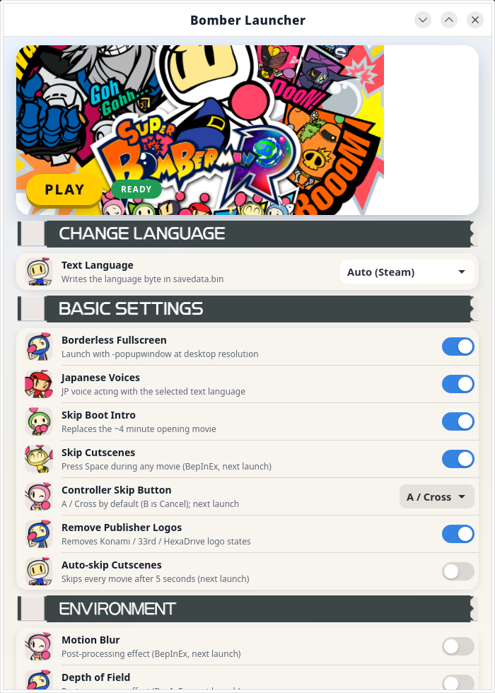

# Bomber Launcher


QoL launcher for **Super Bomberman R** (Steam 702700) on Linux, styled with
artwork extracted from the game itself.



## Features

| Control | Effect |
| --- | --- |
| **Text Language** | Writes the language byte in `savedata.bin` (all 12 shipped locales + Auto) |
| **Borderless Fullscreen** | Launches `steam -applaunch 702700 -popupwindow -screen-width … -screen-height …` |
| **Japanese Voices** | Patches `Assembly-CSharp.dll` so the voice suffix defaults to `_J`; text stays in the selected language |
| **Skip Boot Intro** | Replaces the two ~4-minute opening MP4s with a 1-second clip |
| **Master Difficulty** | BepInEx plugin: activates the hidden Master option in the difficulty menu |
| **Aspect Ratio** | Windowed borderless at Native, 16:9, 16:10, 21:9 or 4:3 |
| **Custom BGM Folder** | Play music from a folder; MP3/FLAC are converted into a local OGG cache |
| **Custom SFX Folder + Shuffle** | Replace or shuffle sound effects by label |
| **Randomizer** | Random story characters and random enemy types |
| **Room Achievement Helper** | One-shot unlock for the three dead online room achievements |
| **Multiplayer** | Smarter bots, random CPU characters, CPU specials, and platform-exclusive IDs |
| **Skip Cutscenes** | BepInEx plugin: Space or a configurable controller button (A/Cross by default) |
| **Soft Reset Combo** | BepInEx plugin: hold LB + RB + Start to fully relaunch the game |
| **Practice Stage Selector** | BepInEx plugin: F9 or L1+R1+X, then choose world/stage/difficulty |
| **Post-processing** | Motion blur, depth of field, bloom, vignette and film grain switches |
| **Low-End Mode** | 30 FPS cap, no post-FX, shadows off, half textures, reduced lights/LOD |
| **Restore Original Files** | Reverts the DLL patch and intro movies from backups |
| **Back Up Save** | Timestamped copy of `savedata.bin` |

Toggles disable themselves while the game is running and every change is
reversible.

## Install

Requires `python3-gi`, GTK 4 and libadwaita 1.4+ (standard on Bazzite and most
modern desktops).

```sh
git clone https://github.com/MusouSlime/bomber-launcher.git
cd bomber-launcher
./install.sh            # menu entry + icon
```

Then rebuild the game artwork for the interface (optional, but the UI is blank
without it):

```sh
python3 -m venv .venv
.venv/bin/pip install UnityPy pillow cryptography
.venv/bin/python tools/extract_ui_assets.py
```

Launch from the application menu or:

```sh
python3 bomber_launcher.py
python3 bomber_launcher.py --check     # state without opening the window
```

Paths can be overridden with `SBR_GAME` and `SBR_MODKIT`.

## Optional: BepInEx code mods

```sh
./install-bepinex.sh
```

Then make Proton load BepInEx's `winhttp.dll`, either with the Steam launch
option:

```
WINEDLLOVERRIDES="winhttp=n,b" %command%
```

or by adding `"winhttp"="native,builtin"` under
`[Software\\Wine\\DllOverrides]` in the game's prefix `user.reg`.

Verified: BepInEx 5.4.23.2 x86 loads under Proton 702700 and the plugin
initializes and writes its config. Cutscene skip and effect toggles apply in
gameplay scenes.

The plugin adds:

- **Skip Cutscenes** — press `Space` or a controller button while any movie is
  playing. A global watcher finds any active `VideoPlayer` and seeks to the end;
  if the movie is paused it falls back to the active movie scene's
  `moveScene()`. The button defaults to A/Cross, with B/Circle as a secondary
  (`SkipJoystickButton`: 0=A, 1=B, 2=X, 3=Y, 4=LB, 5=RB, 6=Back, 7=Start,
  -1=off; `SkipJoystickButtonAlt` defaults to 1). Use A/Cross, not B: the game's Submit-based cutscenes ignore Cancel.
  Publisher logos (Konami, 33rd, HexaDrive) are removed entirely via
  `AutoSkipLogos` (default true). If a skip does nothing, `BepInEx/LogOutput.log` records what happened:
  `UI_ANY injected via …` (native logo/cutscene skip), `Skipping movie …`,
  `Skipping movie scene …`, or `no movie scene found`.
- **Soft Reset / Full Relaunch** — hold **LB + RB + Start**
  (L1 + R1 + Options) for 0.75 s to restart the game process. The keyboard
  shortcut **Ctrl+F10** is also active by default
  (`SoftResetKeyEnabled = true`). Config: `SoftResetEnabled` (default true),
  `SoftResetPadCombo = 4,5,7`, `SoftResetPadHold = 0.75`,
  `SoftResetRelaunch = true`. Set `SoftResetRelaunch = false` to use the old
  in-process title reset instead. The relaunch does not save mid-battle state.
- **Aspect Ratio** — choose Native, 16:9, 16:10, 21:9 or 4:3. The launcher
  fits the chosen shape inside the desktop (with bars if needed) and passes the
  matching `-screen-width/-screen-height` to Unity.
- **Custom BGM / SFX shuffle** — choose folders in the launcher. BGM files are
  flattened into a local OGG cache (MP3, FLAC, M4A, OPUS and WMA are converted
  with ffmpeg); `.ogg`/`.wav` are copied as-is. BGM files are matched by label
  (`BGM_sys_title_01.ogg`, `snd_bgm_btl_stg_01.wav`, …);
  `CustomBgmShuffle` randomizes unmatched tracks. SFX files are matched by
  sound label (`SE_btl_cmn_08.ogg`, or variants `SE_btl_cmn_08_1.ogg`);
  `CustomSfxShuffle` randomizes variants. The folder rows show the selected
  source folder and include a **Clear** action. Config lives under `[Audio]`.
- **Randomizer** — **Random Story Characters** rerolls the character select at
  every `StageSetup`; **Random Enemies** shuffles the enemy types that spawn on
  each story/practice map using that map's own enemy palette, so all models and
  sounds are already loaded. A fixed seed lives in
  `[Randomizer] Seed` (0 = random). **Skip Character Select** jumps straight
  into battle when random characters or a random run is active. Practice has a
  **Starting items** editor for the Custom preset: final Fire/Bombs/Speed levels plus
  Punch, Power Glove, Kick, Remote, Penetration and Elasticity. Editing any
  entry switches Stats to Custom. The F9 menu has
  **Practice**, **Randomizer**, **Multiplayer**, **Settings**, and **Help** tabs,
  starts on **Beginner**, and exposes the run settings as toggles. The main menu **Other**
  entry is replaced with **Bomber QoL**, which opens the same menu; the original
  game options remain available from the Settings tab. Practice has world/stage select, always starts with
  default stats, keeps the normal character-select screen, and has an optional
  **Repeat stage when cleared** switch. Randomizer is a full **Random Run**:
  10 random non-boss stages, then a random undefeated boss; repeat until all 13
  boss battles are beaten, with world 7's final boss last. During a run, fixed
  powerups are moved into random breakable blocks, pickup odds follow the
  difficulty (Beginner all positive, Veteran 25% negative, Expert 50/50, Master
  50/50 plus a stat reset), hidden pickups use a neutral blank icon, and the
  collected item's name pops up above the player. Character randomization only
  happens when **Random characters** is enabled in the Randomizer tab. The
  **Multiplayer** tab has Smarter Bots, Random CPU Opponent, CPU A-button
  specials, and Platform Exclusives toggles. The **Settings** tab exposes the
  runtime launcher toggles (post-processing, results, skips, soft reset, BGM/SFX
  shuffle) and keeps launch-time/file-picker actions in the launcher.
- **Game-over continue** — story game over skips the gem continue/retry dialog
  and returns to the main menu. Config: `[Gameplay] SkipGemContinue`.
- **Platform Exclusives** — unlocks the built-in platform-specific character
  IDs (`M001`–`M003`, `S001`–`S003`, `V001`–`V002`, `N001`–`N002`). Their
  models, icons, and voice keys are present in the Steam files. They are
  player-selectable but have no `CharacterNpcAiInfoDataTable` entries, so they
  are not used as CPU opponents. Nintendo-specific models (Mario/Luigi/etc.)
  are not present.
- **Smarter Bots** — raises local-battle NPC search range to at least 10 tiles
  and caps tactical-target re-evaluation at 0.25 s. This is a real AI parameter
  change, not a stat or achievement shortcut.
- **Room Achievement Helper** — queues `TrophyManager.FuncCreateRoom` ×100 for
  the **Room Creator / Room Master / Room Champ** achievements, since online
  rooms are no longer available. This is an explicit unlock shortcut, not a
  real online match.
- **Practice Stage Selector** — press **F9** or hold **L1 + R1 + X** for
  0.6 s in the title, world map or a battle to open a world/stage/difficulty
  picker. Use **arrow keys / D-pad**
  to move and change values, **Enter / A** to start, **B / Esc** to close, or
  click with the mouse. The **Stats** row selects **Save**, **Default**, **Max**
  or **Custom** item loadouts. It jumps through `StageSetup` into the selected
  story battle and suppresses story saves while practice mode is active, so your
  real save is untouched.
- **Motion Blur / Depth of Field / Bloom / Vignette / Film Grain** —
  independent switches. Environment toggles save immediately to the plugin
  config and reload on the next launcher start.

These are exposed in the launcher and stored in
`BepInEx/config/bomber.qol.cfg`; changes apply on the next launch. Plugin
source is in `plugin/` (`./plugin/build.sh`).

## Launching straight into Master

With the BepInEx plugin installed, add this to Steam launch options on Linux:

```
BOMBER_FORCE_MASTER=1 %command%
```

The plugin forces the `super` difficulty when the world map loads. There is no
native game argument; the executable does not parse custom command line flags.

## Setup helpers

- **Install BepInEx + Plugin** (both launchers): downloads BepInEx x86, copies
  the plugin and sets the Linux `winhttp` override automatically.
- **Game Folder** (both launchers): auto-detects Steam libraries, but a
  **Choose…** button lets you point at a custom install; **Auto** returns to
  Steam detection. The choice is remembered.
- **Extract Game Artwork** (Linux): rebuilds the interface art from the selected
  game folder into the writable art folder. The toast shows the exact output
  path, and the launcher reloads it on the next start.

## Distribution

Both builds are portable: no installer, no registry changes, and data lives
next to the application.

- **Linux (portable AppImage):** `packaging/build-appimage-portable.sh`
  produces `dist/BomberLauncher-portable-x86_64.AppImage`. It bundles Python,
  PyGObject, GTK 4 and libadwaita; settings and backups go to
  `BomberLauncher.data/` beside the AppImage.
- **Linux (thin dev build):** `packaging/build-appimage.sh` produces a small
  AppImage that uses the host GTK stack.
- **Windows:** `windows/BomberLauncher` is a native WinForms port, published as
  a self-contained zip. Settings and backups go to `data/` beside the exe. See
  `windows/README.md`.

Neither build includes Konami artwork; the UI falls back to a neutral layout
and can load locally extracted art.

## Artwork and legal

No Konami assets are stored in this repository. `tools/extract_ui_assets.py`
decrypts the game's own UnityFS packs and rebuilds the banner, avatars, menu
wordmarks and bars into `assets/` on your machine. The only committed media is
`assets/intro_blank.mp4` (a generated 1-second black clip).

Super Bomberman R and its artwork are © Konami. This is an unofficial,
non-commercial quality-of-life tool and is not affiliated with Konami or
HexaDrive. The screenshot shows in-game artwork.

## How it works

- **Dual audio:** the single `#US` string literal `_E` in
  `Assembly-CSharp.dll` becomes `_J` (same length). The default returned by
  `LocaleManager.getVoiceLabelSuffix()` changes for every non-Japanese text
  language, which switches both the loaded `sound/**/*_j` packs and the
  `V_*_J` / `SND_MOV_*_J` clip names. The JP chara pack covers all 1,951 voice
  lines and all 23 movie audio packs have `_j` twins.
- **Language:** `savedata.bin` is an xorshift32-XOR container with MD5-hashed
  chunks. The launcher decodes it, edits `SystemData.language` (offset 1132 of
  the 1352-byte blob), re-hashes and re-encrypts. Unmodified round-trips are
  byte-identical; each write keeps a timestamped backup.
- **Intro skip:** originals move to the modkit backups; the bundled 1080p30
  one-second clip is copied into `StreamingAssets/bin/`.
- **Packs:** AES-128-CBC UnityFS bundles, key derived from the file name via
  PBKDF2-HMAC-SHA1 (1103 iterations). See `tools/sbr_pack.py`.

## Safety

- Close the game before toggling mods or changing language.
- Steam → *Properties → Installed Files → Verify integrity* restores vanilla
  files and removes the mods; re-apply afterwards.
- If Steam Cloud overwrites an older `savedata.bin`, set the language again
  with the game closed.
- Backups live in `~/Projects/sbr-modkit` by default (override with
  `SBR_MODKIT`).

## Layout

```
bomber_launcher.py        GTK4/libadwaita app
install.sh                menu entry + icon
assets/                   generated from the game (gitignored)
docs/screenshot.png
modkit/                   CLI fallbacks (dual audio, intros, save, pack crypto)
tools/extract_ui_assets.py
tools/sbr_pack.py
plugin/                    BepInEx plugin source + prebuilt DLL
windows/                   native Windows (WinForms) port
packaging/                 AppImage build
install-bepinex.sh
```

## License

MIT for the code (see `LICENSE`). Game assets remain Konami's.
